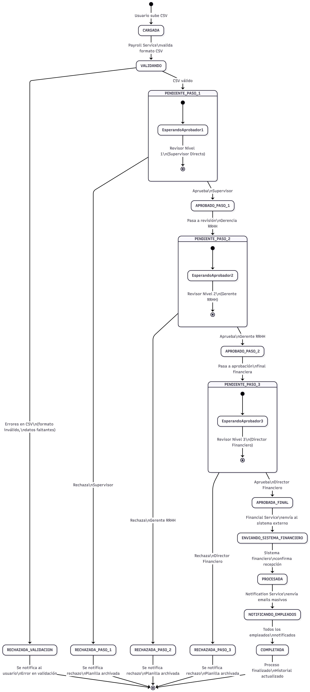
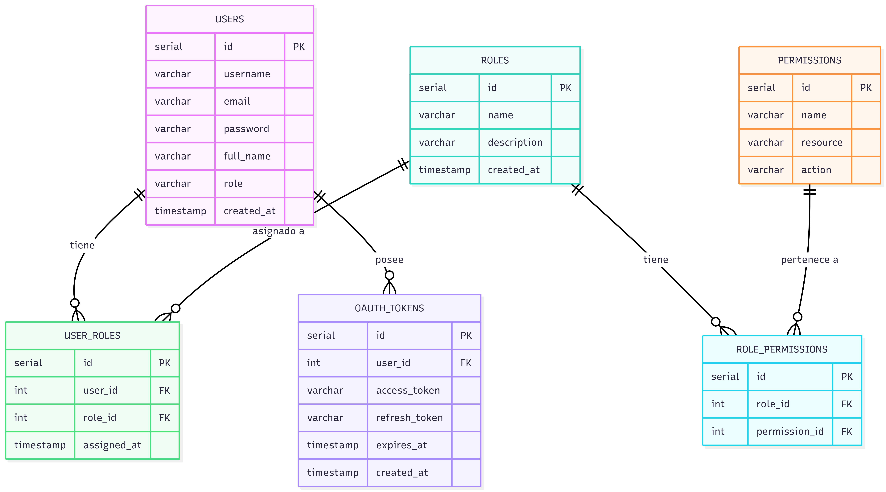
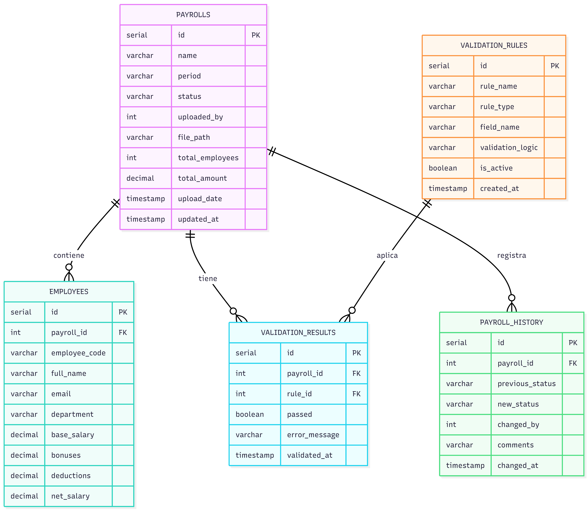
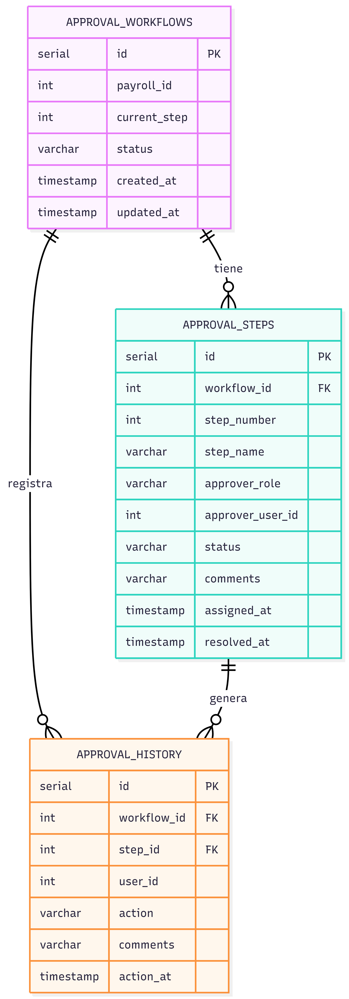
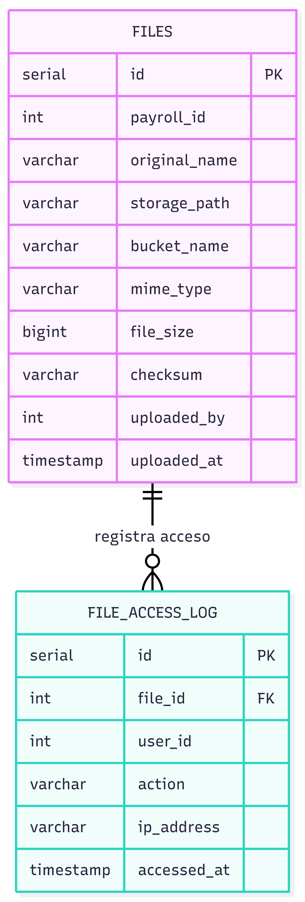
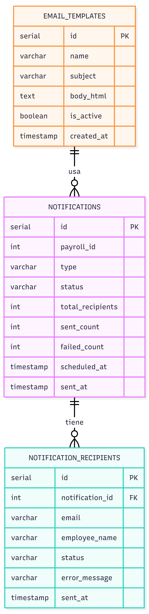
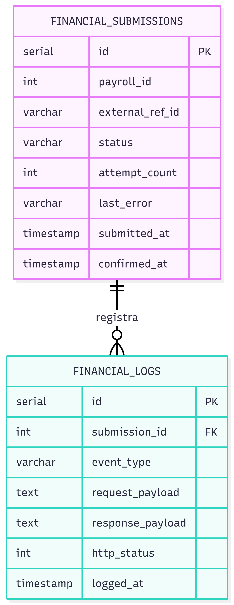
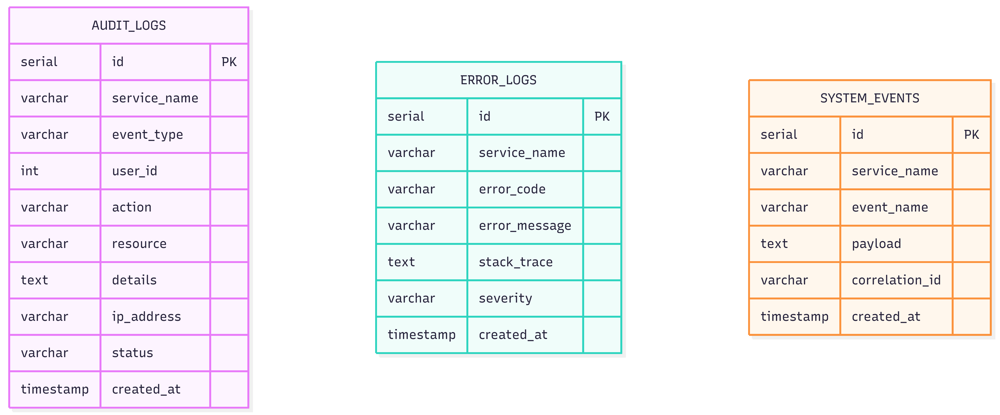

# Práctica 3 - Arquitectura de Microservicios: Sistema de Planillas

**Estudiante:** Rodrigo Sebastian Castro Aguilar  
**Carné:** 202204496  
**Sección:** B  
**Curso:** Software Avanzado - Universidad de San Carlos de Guatemala  
**Fecha:** Febrero 2026

---

## Descripción del Problema

El sistema de planillas de la empresa funciona bajo un esquema **monolítico**, lo cual provoca:

- Lentitud en épocas de alta demanda (quincenas, fin de mes, aguinaldo)
- Incapacidad de escalar componentes individualmente
- Un fallo en cualquier módulo colapsa todo el sistema
- Dificultad para mantener y actualizar el código
- Cuellos de botella en el procesamiento de planillas masivas

**Solución:** Migrar a una arquitectura de microservicios distribuida.

---

## Solución Propuesta

Se propone una arquitectura basada en **7 microservicios independientes** que se comunican mediante:
- **REST API** para comunicación síncrona
- **Message Broker (RabbitMQ)** para comunicación asíncrona
- **API Gateway** como punto de entrada único

Cada microservicio tiene:
- Su propia base de datos (PostgreSQL en Supabase)
- Responsabilidad única y bien definida
- Escalabilidad independiente
- Despliegue independiente

---

## Arquitectura General


---

## Microservicios Definidos

### 1. Auth Service (Integración Práctica 2)
**Puerto:** 4000  
**Responsabilidad:** Autenticación y autorización de usuarios

**Funcionalidades:**
- Integración con OAuth corporativo (token 12 horas)
- Sistema complementario de JWT con cookies HttpOnly (de P2)
- Gestión de roles y permisos (Admin, Supervisor, Gerente RRHH, Director Financiero)
- Encriptación AES de datos sensibles
- Hash de contraseñas con bcrypt

**Endpoints principales:**
- `POST /api/auth/login` - Login con OAuth corporativo
- `GET /api/auth/me` - Info del usuario actual
- `POST /api/auth/refresh` - Renovar token
- `GET /api/auth/permissions` - Permisos del usuario

**Base de datos:** PostgreSQL (Supabase) - Reutiliza la de P2

---

### 2. Payroll Service
**Puerto:** 4001  
**Responsabilidad:** Gestión completa de planillas

**Funcionalidades:**
- Recibir y parsear archivos CSV de planillas
- Validar datos según reglas de negocio internas
- Gestionar ciclo de vida de la planilla (estados)
- Consultar historial de planillas procesadas
- Calcular totales (salarios, deducciones, bonificaciones)

**Endpoints principales:**
- `POST /api/payroll/upload` - Subir CSV de planilla
- `GET /api/payroll` - Listar todas las planillas
- `GET /api/payroll/:id` - Detalle de planilla
- `GET /api/payroll/:id/employees` - Empleados de planilla
- `GET /api/payroll/history` - Historial completo

**Estados de una planilla:**
```
CARGADA → VALIDANDO → PENDIENTE_PASO_1 → APROBADO_PASO_1 
→ PENDIENTE_PASO_2 → APROBADO_PASO_2 → PENDIENTE_PASO_3 
→ APROBADA_FINAL → PROCESADA → COMPLETADA
```

**Reglas de validación del CSV:**
- Formato de columnas obligatorio: `codigo,nombre,email,departamento,salario_base,bonificaciones,deducciones`
- El email debe ser válido
- El salario base debe ser mayor a 0
- No puede haber códigos de empleado duplicados
- La suma de deducciones no puede superar el salario base

**Base de datos:** PostgreSQL (Supabase) - payroll_db

---

### 3. Approval Service
**Puerto:** 4002  
**Responsabilidad:** Gestión del flujo de aprobación en 3 pasos

**Funcionalidades:**
- Crear workflow de aprobación al recibir planilla validada
- Gestionar cada paso de aprobación
- Notificar al siguiente aprobador
- Registrar historial de decisiones
- Manejar rechazos en cualquier paso

**Endpoints principales:**
- `POST /api/approval/start/:payrollId` - Iniciar flujo de aprobación
- `GET /api/approval/:workflowId` - Estado actual del workflow
- `POST /api/approval/:workflowId/approve` - Aprobar paso actual
- `POST /api/approval/:workflowId/reject` - Rechazar planilla
- `GET /api/approval/history` - Historial de aprobaciones

**Los 3 pasos:**

| Paso | Rol | Responsabilidad |
|------|-----|----------------|
| 1 | Supervisor Directo | Revisión inicial y validación de datos |
| 2 | Gerente de RRHH | Validación de políticas de empresa |
| 3 | Director Financiero | Aprobación final y autorización de pago |

**Base de datos:** PostgreSQL (Supabase) - approval_db

---

### 4. Storage Service
**Puerto:** 4003  
**Responsabilidad:** Almacenamiento y recuperación de archivos CSV

**Funcionalidades:**
- Upload de archivos CSV a Supabase Storage
- Download de archivos CSV del historial
- Gestión de metadata de archivos
- Verificación de integridad (checksum)
- Control de acceso a archivos

**Endpoints principales:**
- `POST /api/storage/upload` - Subir archivo CSV
- `GET /api/storage/:fileId/download` - Descargar archivo
- `GET /api/storage/:payrollId/files` - Archivos de una planilla
- `DELETE /api/storage/:fileId` - Eliminar archivo

**Tecnología de almacenamiento:** Supabase Storage
- Bucket: `planillas-csv`
- Organización: `/{año}/{mes}/{payroll_id}/{archivo.csv}`
- Políticas RLS para control de acceso
- URLs firmadas para descarga segura

**Base de datos:** PostgreSQL (Supabase) - storage_db

---

### 5. Notification Service
**Puerto:** 4004  
**Responsabilidad:** Envío de notificaciones por correo electrónico

**Funcionalidades:**
- Envío masivo de correos a todos los empleados de una planilla
- Sistema de cola para manejar grandes volúmenes
- Templates de correo personalizados
- Reintentos automáticos en caso de fallo
- Registro de estado por destinatario

**Endpoints principales:**
- `POST /api/notification/send` - Enviar notificación
- `GET /api/notification/:id/status` - Estado de envío
- `GET /api/notification/history` - Historial de notificaciones

**Template del correo a empleados:**
```
Asunto: Su pago está en proceso de depósito - [Período]

Estimado@ [Nombre del Empleado]:

Le informamos que la planilla correspondiente al período [Período]
ha sido aprobada y su pago está en proceso de depósito.

Detalles:
- Salario Base:      Q [Monto]
- Bonificaciones:    Q [Monto]
- Deducciones:       Q [Monto]
- Total a recibir:   Q [Monto]

El depósito se realizará en un plazo de 24-48 horas hábiles.

Atentamente,
Departamento de Recursos Humanos
```

**Proveedor de email:** Nodemailer con SMTP

**Base de datos:** PostgreSQL (Supabase) - notification_db

---

### 6. Financial Service
**Puerto:** 4005  
**Responsabilidad:** Integración con el sistema financiero externo

**Funcionalidades:**
- Enviar planillas aprobadas al sistema financiero externo
- Manejo de reintentos en caso de fallo (máximo 3 intentos)
- Registro de estado de cada envío
- Confirmar recepción exitosa

**Endpoints principales:**
- `POST /api/financial/submit/:payrollId` - Enviar planilla
- `GET /api/financial/:submissionId/status` - Estado del envío
- `GET /api/financial/history` - Historial de envíos

**Lógica de reintentos:**
```
Intento 1: Inmediato
Intento 2: 5 minutos después
Intento 3: 30 minutos después
Si falla el intento 3: Alerta al administrador
```

**Base de datos:** PostgreSQL (Supabase) - financial_db

---

### 7. Logging Service
**Puerto:** 4006  
**Responsabilidad:** Logging centralizado y auditoría del sistema

**Funcionalidades:**
- Recibir logs de todos los microservicios
- Almacenar eventos de auditoría
- Registrar errores del sistema
- Proveer API para consultar logs
- Alertas por eventos críticos

**Endpoints principales:**
- `POST /api/logs/audit` - Registrar evento de auditoría
- `POST /api/logs/error` - Registrar error
- `GET /api/logs` - Consultar logs con filtros
- `GET /api/logs/audit` - Consultar auditoría
- `GET /api/logs/errors` - Consultar errores

**Tipos de logs:**
- `AUDIT`: Acciones de usuarios (login, aprobaciones, etc.)
- `ERROR`: Errores del sistema
- `SYSTEM`: Eventos del sistema (inicio/parada de servicios)
- `SECURITY`: Intentos de acceso no autorizados

**Base de datos:** PostgreSQL (Supabase) - logging_db

---

## Comunicación entre Servicios

### Comunicación Síncrona (REST)
Se usa para operaciones que requieren respuesta inmediata:

```
Cliente → API Gateway → Microservicio específico
```

| Origen | Destino | Tipo | Descripción |
|--------|---------|------|-------------|
| API Gateway | Auth Service | REST | Validar JWT en cada request |
| API Gateway | Payroll Service | REST | CRUD de planillas |
| API Gateway | Approval Service | REST | Gestión de aprobaciones |
| API Gateway | Storage Service | REST | Upload/Download archivos |
| API Gateway | Logging Service | REST | Consultar logs |

### Comunicación Asíncrona (Message Broker - RabbitMQ)
Se usa para operaciones que no requieren respuesta inmediata:

```
Servicio Emisor → RabbitMQ → Servicio Consumidor
```

| Evento | Emisor | Consumidor | Descripción |
|--------|--------|------------|-------------|
| `payroll.uploaded` | Payroll Service | Approval Service | Inicia flujo de aprobación |
| `payroll.approved_step1` | Approval Service | Logging Service | Log de aprobación paso 1 |
| `payroll.approved_step2` | Approval Service | Logging Service | Log de aprobación paso 2 |
| `payroll.approved_final` | Approval Service | Financial Service | Enviar al sistema financiero |
| `payroll.approved_final` | Approval Service | Notification Service | Notificar a empleados |
| `payroll.rejected` | Approval Service | Notification Service | Notificar rechazo |
| `financial.submitted` | Financial Service | Logging Service | Log de envío financiero |
| `notification.sent` | Notification Service | Logging Service | Log de notificación |

## Flujo de Aprobación




### Reglas del Flujo:
- Cada paso debe ser aprobado por un usuario con el rol específico
- Un usuario no puede aprobar el mismo paso dos veces
- Si se rechaza en cualquier paso, el proceso termina
- El paso 3 desencadena automáticamente el envío financiero y las notificaciones
- Todo el historial queda registrado con usuario, fecha y comentarios

---

## Almacenamiento de Archivos CSV

### Tecnología: Supabase Storage

Se utiliza **Supabase Storage** como solución de almacenamiento por las siguientes razones:
- Ya está configurado en el proyecto (P2 usa Supabase)
- No requiere configuración adicional de servidores
- Ofrece URLs firmadas para descarga segura
- Tiene políticas RLS (Row Level Security)
- Escalable y con buena integración con PostgreSQL


```
planillas-csv/2026/02/payroll_001/original.csv
planillas-csv/2026/02/payroll_001/processed.csv
```

### Seguridad:
- Solo usuarios autenticados pueden subir archivos
- URLs firmadas con expiración de 1 hora para descargas
- Políticas RLS basadas en el rol del usuario
- Archivos organizados por período para fácil búsqueda

### Formato del CSV requerido:
```csv
codigo,nombre,email,departamento,salario_base,bonificaciones,deducciones
EMP001,Juan Perez,juan@empresa.com,TI,5000.00,500.00,200.00
EMP002,Maria Garcia,maria@empresa.com,RRHH,4500.00,400.00,180.00
EMP003,Carlos Lopez,carlos@empresa.com,Finanzas,6000.00,600.00,240.00
```

---

## Sistema de Logging

### Estrategia: Logging Centralizado

Todos los microservicios envían sus logs al **Logging Service** a través de:
- Llamadas directas REST para logs críticos/síncronos
- Message Broker (RabbitMQ) para logs de eventos asíncronos

### Ejemplos de Logs del Sistema:

```json
// Login exitoso
{
  "service": "auth-service",
  "event_type": "AUDIT",
  "user_id": 1,
  "action": "LOGIN",
  "resource": "/api/auth/login",
  "status": "SUCCESS",
  "ip_address": "192.168.1.1",
  "timestamp": "2026-02-16T10:30:00Z"
}

// Planilla aprobada (paso 3)
{
  "service": "approval-service",
  "event_type": "AUDIT",
  "user_id": 5,
  "action": "APPROVE_STEP_3",
  "resource": "payroll/42",
  "details": "Planilla Q15 aprobada para pago",
  "status": "SUCCESS",
  "timestamp": "2026-02-16T14:00:00Z"
}

// Error en envío financiero
{
  "service": "financial-service",
  "event_type": "ERROR",
  "error_code": "FINANCIAL_CONNECTION_ERROR",
  "error_message": "Timeout al conectar con sistema externo",
  "severity": "HIGH",
  "timestamp": "2026-02-16T14:05:00Z"
}
```

### Consulta de Logs:
Los administradores pueden consultar logs por:
- Rango de fechas
- Tipo de log (AUDIT, ERROR, SYSTEM)
- Servicio origen
- Usuario específico
- Nivel de severidad

---

## Diagramas ER por Servicio

Los diagramas ER completos se encuentran en la carpeta `diagramas/er/`:

### Auth Service DB


### Payroll Service DB

### Approval Service DB


### Storage Service DB


### Notification Service DB

### Financial Service DB

### Logging Service DB


---

## Tecnologías y Justificación

### Backend de Microservicios
**Node.js + Express + TypeScript**

Ventajas:
- Mismo stack que la Práctica 2 (reutilización)
- Alto rendimiento para operaciones I/O
- Gran ecosistema de librerías
- TypeScript previene errores en desarrollo

### Base de Datos
**PostgreSQL (Supabase) - Una por microservicio**

Ventajas:
- Aislamiento de datos por servicio
- Ya configurado en P2
- Panel visual para administración
- Escalable y confiable

### Message Broker
**RabbitMQ**

Ventajas:
- Comunicación asíncrona entre servicios
- Desacoplamiento de servicios
- Reintentos automáticos
- Alta disponibilidad

### Almacenamiento de Archivos
**Supabase Storage**

Ventajas:
- Integrado con el proyecto actual
- Sin configuración de servidor adicional
- URLs firmadas para seguridad
- Escalable automáticamente

### API Gateway
**Express Gateway / Kong / custom Node.js**

Ventajas:
- Punto de entrada único
- Rate limiting centralizado
- Autenticación centralizada
- Load balancing

### Notificaciones Email
**Nodemailer + SMTP**

Ventajas:
- Nodemailer: Open source, sin costo
- SendGrid: Alta deliverability, tracking
- Templates HTML personalizados

### Autenticación
**OAuth 2.0 corporativo + JWT**

Ventajas:
- Token 12h del OAuth corporativo
- JWT propio con 15 min para mayor seguridad
- Cookies HttpOnly para protección XSS

---

## API Gateway

El API Gateway actúa como punto de entrada único para todos los clientes.

### Responsabilidades:
- **Routing:** Dirige las peticiones al microservicio correcto
- **Autenticación:** Valida el JWT en cada petición
- **Rate Limiting:** Máximo 100 requests/minuto por usuario
- **Load Balancing:** Distribuye carga entre instancias
- **Logging:** Registra todas las peticiones
- **CORS:** Maneja políticas de origen cruzado

### Tabla de Routing:

| Ruta | Microservicio | Puerto |
|------|--------------|--------|
| `/api/auth/*` | Auth Service | 4000 |
| `/api/payroll/*` | Payroll Service | 4001 |
| `/api/approval/*` | Approval Service | 4002 |
| `/api/storage/*` | Storage Service | 4003 |
| `/api/notification/*` | Notification Service | 4004 |
| `/api/financial/*` | Financial Service | 4005 |
| `/api/logs/*` | Logging Service | 4006 |

---
