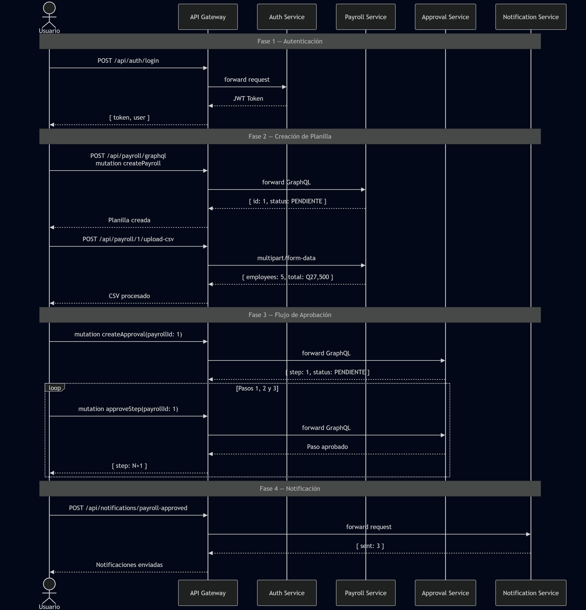
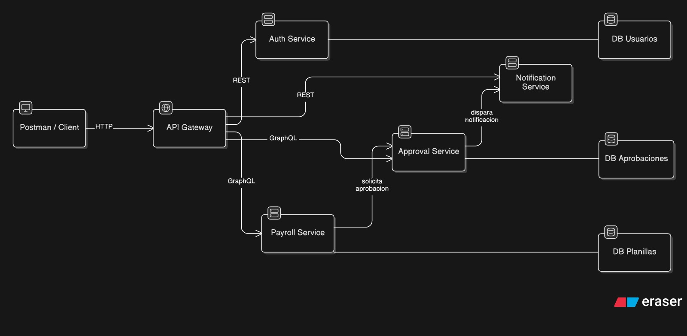
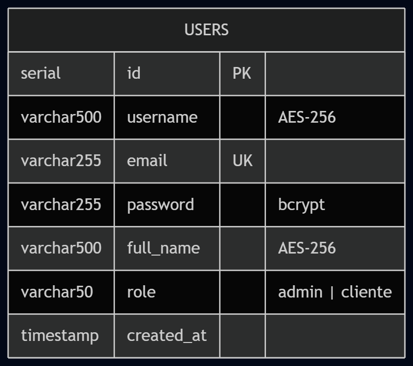
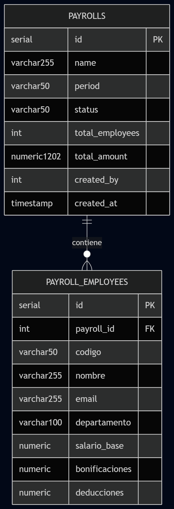
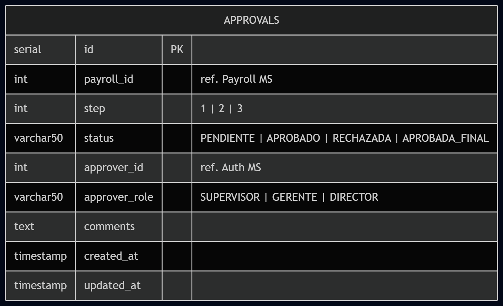
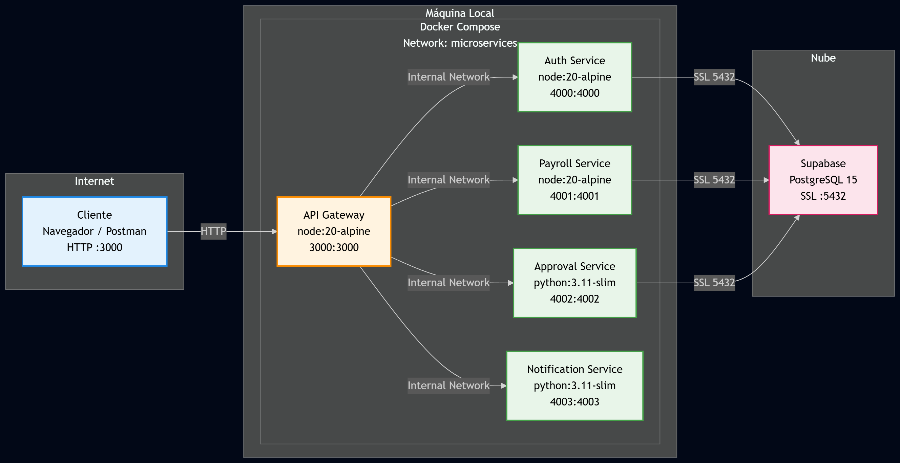

# Manual Técnico — Práctica 4
## Sistema de Gestión de Planillas — Arquitectura de Microservicios

**Universidad San Carlos de Guatemala**  
Facultad de Ingeniería — ECYS  
Software Avanzado — Sección B  

### Información:
Rodrigo Sebastián Castro Aguilar  
Carné: 202204496 
Sección B 
Fecha Febrero 2026

---

## 1. Descripción del Sistema

El sistema implementado es una plataforma de gestión de planillas empresariales construida sobre una arquitectura de microservicios. Permite a las organizaciones crear planillas salariales, cargar empleados mediante archivos CSV, gestionar un flujo de aprobación de tres pasos jerárquicos, y notificar a los involucrados al finalizar el proceso.

El sistema está compuesto por cinco contenedores Docker independientes que se comunican a través de un API Gateway centralizado, siguiendo los principios de desacoplamiento y responsabilidad única.

### 1.1 Flujo General del Sistema



El proceso completo sigue esta secuencia lógica:

1. El usuario se registra y autentica mediante el Auth Service, obteniendo un JWT.
2. Con el token JWT, crea una planilla en el Payroll Service via GraphQL.
3. Sube un archivo CSV con los datos de los empleados al Payroll Service.
4. Inicia el flujo de aprobación en el Approval Service via GraphQL.
5. Tres aprobadores (Supervisor → Gerente → Director) aprueban secuencialmente.
6. El Notification Service envía confirmaciones al completarse el proceso.

---

## 2. Microservicios

### 2.1 API Gateway — TypeScript | Puerto 3000

> **Razón de existencia:** Punto de entrada único para todos los clientes. Sin el Gateway, cada cliente tendría que conocer la URL y puerto de cada microservicio, lo cual rompe el principio de encapsulamiento y hace la arquitectura frágil ante cambios.

El API Gateway actúa como el director de tráfico del sistema. Recibe todas las solicitudes entrantes y las redirige al microservicio correspondiente según la ruta:

| Ruta | Destino |
|------|---------|
| `/api/auth/*` | Auth Service :4000 |
| `/api/payroll/*` | Payroll Service :4001 |
| `/api/approval/*` | Approval Service :4002 |
| `/api/notifications/*` | Notification Service :4003 |

Adicionalmente implementa:
- **Rate limiting:** 200 solicitudes por 15 minutos por IP
- **CORS:** Control de orígenes permitidos
- **Logging:** Centralizado con Morgan
- **Proxy transparente:** Usa `http-proxy-middleware` para forwarding de requests y responses

---

### 2.2 Auth Service — TypeScript | Puerto 4000

> **Razón de existencia:** Centralizar toda la lógica de autenticación y autorización. Este servicio es la integración directa del Auth Service de la Práctica 2, reutilizado como microservicio independiente.

Es el guardián del sistema. Ningún dato sensible puede accederse sin pasar primero por este servicio. Gestiona el ciclo de vida completo de la identidad del usuario:

- **Registro:** Valida unicidad del email, encripta datos sensibles con AES-256, hashea la contraseña con bcrypt.
- **Login:** Verifica credenciales, emite JWT con expiración de 15 minutos, guarda token en cookie HttpOnly.
- **Validación:** Cualquier microservicio puede verificar un token llamando a `/api/auth/validate`.
- **Logout:** Limpia las cookies HttpOnly del cliente.

**Estructura de la tabla `users`:**

| Campo | Tipo | Detalle |
|-------|------|---------|
| id | SERIAL PK | Identificador único |
| username | VARCHAR(500) | Encriptado con AES-256 |
| email | VARCHAR(255) UNIQUE | Texto plano (necesario para login) |
| password | VARCHAR(255) | Hasheado con bcrypt 10 rounds |
| full_name | VARCHAR(500) | Encriptado con AES-256 |
| role | VARCHAR(50) | 'admin' o 'cliente' |
| created_at | TIMESTAMP | Fecha de registro |

---

### 2.3 Payroll Service — TypeScript | Puerto 4001

> **Razón de existencia:** Gestionar el ciclo de vida completo de las planillas salariales. Es el núcleo de negocio del sistema y justifica el uso de GraphQL por la complejidad de sus consultas y relaciones de datos.

Maneja dos tipos de operaciones:
- **GraphQL** para CRUD de planillas (el cliente controla exactamente qué campos obtiene)
- **REST multipart/form-data** para carga masiva de empleados via CSV

Al cargar un CSV, el servicio:
1. Elimina los empleados anteriores de esa planilla
2. Inserta los nuevos registros uno a uno
3. Calcula `salario_neto = salario_base + bonificaciones - deducciones`
4. Actualiza `total_employees` y `total_amount` en la planilla
5. Cambia el estado de la planilla a `VALIDANDO`

**Estados posibles de una planilla:**

```
PENDIENTE → VALIDANDO → PENDIENTE_APROBACION → APROBADA
                                             → RECHAZADA
                                             → COMPLETADA
```

---

### 2.4 Approval Service — Python | Puerto 4002

> **Razón de existencia:** Implementar el flujo de aprobación jerárquica de tres niveles. Se eligió Python con FastAPI y Strawberry (GraphQL) para demostrar que la arquitectura de microservicios integra múltiples lenguajes sin fricción.

Modela el proceso de aprobación empresarial real donde una planilla debe ser revisada por múltiples niveles jerárquicos:

| Paso | Rol | Responsabilidad |
|------|-----|----------------|
| 1 | Supervisor | Revisión operativa de los datos |
| 2 | Gerente RRHH | Validación de políticas salariales |
| 3 | Director Financiero | Aprobación presupuestaria final |

Cada paso se registra con: ID del aprobador, rol, timestamp y comentarios opcionales. Si cualquier paso es rechazado, el flujo se detiene y la planilla queda `RECHAZADA` con el motivo registrado.

---

### 2.5 Notification Service — Python | Puerto 4003

> **Razón de existencia:** Separar el sistema de notificaciones siguiendo el principio de responsabilidad única. En producción se conectaría a un servidor SMTP o proveedor como SendGrid; en esta implementación registra las notificaciones en memoria para demostración.

Expone endpoints para:
- Notificación individual (`POST /api/notifications/send`)
- Notificación masiva (`POST /api/notifications/bulk`)
- Eventos predefinidos: aprobación y rechazo de planillas
- Historial de notificaciones (`GET /api/notifications`)

---

## 3. Tecnologías Utilizadas — Justificación

### 3.1 Docker y Docker Compose

Docker resuelve el problema clásico de "en mi máquina funciona". Cada microservicio se empaqueta con todas sus dependencias en una imagen inmutable.

Docker Compose orquesta el arranque de los cinco contenedores en una red privada (`p4_net`), garantizando que se comuniquen por nombre de servicio (`auth-service`, `payroll-service`, etc.) sin exponer puertos innecesarios al exterior.

```yaml
# Los servicios se resuelven por nombre DNS interno
AUTH_SERVICE_URL: http://auth-service:4000
PAYROLL_SERVICE_URL: http://payroll-service:4001
```

---

### 3.2 JWT — JSON Web Tokens

JWT es un estándar abierto (RFC 7519) para transmitir información segura entre partes como un objeto JSON firmado digitalmente.

**Estructura del token:**

```
Header.Payload.Signature

Header:    { "alg": "HS256", "typ": "JWT" }
Payload:   { "userId": 1, "email": "...", "role": "admin", "iat": ..., "exp": ... }
Signature: HMAC-SHA256(base64(header) + "." + base64(payload), JWT_SECRET)
```

**Ventaja clave:** Cada microservicio verifica la firma del token con el mismo `JWT_SECRET` **sin consultar la base de datos** — esto es la esencia del enfoque stateless. No hay sesiones centralizadas, no hay bottleneck.

El token expira en 15 minutos, se transmite en cookies HttpOnly (protegidas contra XSS) y en el header `Authorization: Bearer`.

---

### 3.3 GraphQL

GraphQL es un lenguaje de consulta para APIs desarrollado por Meta. A diferencia de REST donde el servidor define la estructura de cada respuesta, en GraphQL **el cliente especifica exactamente qué campos necesita**.

**Implementaciones en este proyecto:**

| Servicio | Librería | Lenguaje |
|---------|---------|---------|
| Payroll Service | Apollo Server 4 | TypeScript |
| Approval Service | Strawberry | Python |

**Ejemplo de consulta GraphQL:**
```graphql
# El cliente pide solo los campos que necesita
query {
  payroll(id: 1) {
    payroll { id name status total_amount }
    employees { nombre salario_base salario_neto }
  }
}
```

**Justificación de usarlo en estos dos servicios:** sus datos tienen relaciones complejas (planilla → empleados con cálculos derivados, aprobación → historial de pasos). GraphQL permite obtener todo en una sola consulta evitando el over-fetching típico de REST.

---

### 3.4 Supabase — PostgreSQL

Supabase es una plataforma BaaS (Backend-as-a-Service) que provee PostgreSQL administrado con alta disponibilidad, SSL automático, backups, y connection pooling via PgBouncer.

**Razones técnicas de elección:**

- **Connection Pooling:** PgBouncer en modo Transaction (puerto 6543) permite que múltiples microservicios compartan conexiones eficientemente
- **SSL automático:** Todas las conexiones van encriptadas sin configuración adicional
- **PostgreSQL puro:** Compatible con cualquier cliente estándar (`pg` para Node.js, `asyncpg` para Python)

Cada microservicio tiene sus propias tablas siguiendo el principio de base de datos separada por servicio, aunque compartan la instancia física — el aislamiento lógico es suficiente para este contexto académico.

---

### 3.5 AES-256 y bcrypt

Para proteger datos sensibles se implementaron dos estrategias complementarias:

**AES-256 (Advanced Encryption Standard):**
- Cifrado simétrico para datos que necesitan ser **recuperados** (username, full_name)
- Clave de mínimo 32 caracteres definida en `AES_SECRET_KEY`
- Los datos se almacenan cifrados y se descifran al leerlos

**bcrypt:**
- Función de hash **unidireccional** para contraseñas
- 10 rounds de sal — hace computacionalmente costoso un ataque de fuerza bruta
- Las contraseñas **nunca se pueden recuperar**, solo verificar
- `bcrypt.compare(passwordIngresada, hashAlmacenado)` → `true/false`

---

## 4. Diagramas

### 4.1 Diagrama de Arquitectura

Muestra la visión conceptual del sistema desde la perspectiva de comunicación entre componentes. Responde a la pregunta **"¿Qué hace cada parte y cómo se relacionan?"**

- Capa de cliente como punto de entrada
- API Gateway como único punto de contacto que oculta la complejidad interna
- Cuatro microservicios con sus responsabilidades y bases de datos asociadas
- Flechas sólidas: flujo principal del Gateway
- Flechas punteadas: comunicación inter-servicios (Payroll→Approval, Approval→Notification, Auth valida tokens en todos)

Es el primer documento que debe consultarse para entender el sistema a alto nivel. Sigue el principio de Separación de Preocupaciones: cada caja tiene una sola razón para existir.



---

### 4.2 Diagramas ER por Microservicio

Se diseñaron **tres diagramas ER separados** (uno por microservicio con base de datos) en lugar de un único diagrama consolidado. Esta decisión refleja la filosofía de microservicios: **cada servicio es dueño de sus datos**.

- **ER Auth Service:** Entidad `users` con campos encriptados marcados explícitamente. El Auth Service conoce todo sobre la identidad pero nada sobre el negocio.



- **ER Payroll Service:** Dos entidades relacionadas `payrolls` y `payroll_employees` con relación 1:N.



- **ER Approval Service:** Entidad `approvals` con referencias lógicas (no FK físicas) a datos de otros servicios — en microservicios las FK cruzadas entre servicios se evitan para mantener el desacoplamiento.



---

### 4.3 Diagrama de Despliegue

Muestra la perspectiva operacional: **cómo los contenedores Docker se organizan en la infraestructura real**, qué puertos se exponen, cómo se comunican internamente, y cuáles son las dependencias de servicios externos.

Es el documento de referencia para DevOps. Muestra explícitamente la red Docker `p4_net` como el bus de comunicación interno, y las conexiones SSL hacia Supabase en la nube.



---

## 5. Swagger — Contrato de Microservicios

Swagger (OpenAPI 3.0) es el estándar de la industria para documentar APIs REST. El archivo `docs/swagger.yaml` define el contrato completo del sistema:

- Todos los endpoints de los 5 servicios con sus rutas exactas
- Métodos HTTP, parámetros de entrada y tipos de datos
- Esquemas de request y response con ejemplos reales
- Mecanismo de autenticación (Bearer JWT)
- Códigos de respuesta posibles (200, 201, 400, 401, 404, 503)

> **Cómo visualizarlo:** Copia el contenido de [Swagger.yml](Swagger.yml) y pégalo en https://editor.swagger.io — se genera automáticamente una interfaz interactiva donde puedes probar cada endpoint.

El contrato sirve como acuerdo entre el backend y cualquier cliente. Si un endpoint cambia sin actualizar el swagger, el contrato se rompe — esto es especialmente crítico en microservicios donde múltiples equipos pueden consumir los mismos APIs.

---

## 6. Modelo de Seguridad

El sistema implementa seguridad en capas (defensa en profundidad):

| Capa | Mecanismo | Protección |
|------|-----------|-----------|
| Red | Docker Network privada `p4_net` | Servicios no accesibles desde el exterior |
| Transporte | SSL/TLS (Supabase) | Datos en tránsito encriptados |
| Autenticación | JWT HS256 / 15 min | Sesiones de corta duración |
| Datos en reposo | AES-256 + bcrypt | Datos sensibles nunca en texto plano |
| API | Rate Limiting 200/15min | Protección contra abuso y DDoS básico |
| Cookies | HttpOnly + SameSite:strict | Protección contra XSS y CSRF |

---

*Rodrigo Sebastián Castro Aguilar — 202204496 — Software Avanzado Sección B — USAC 2026*