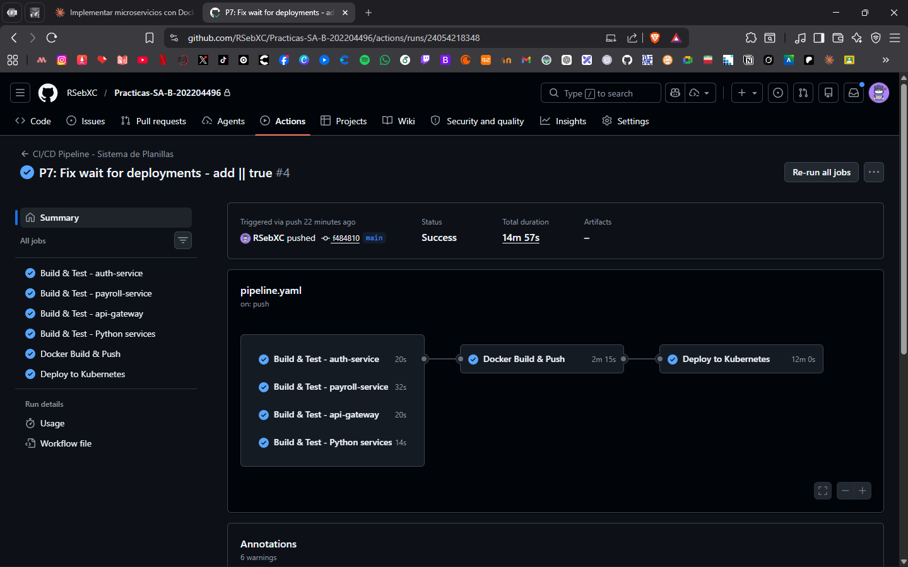
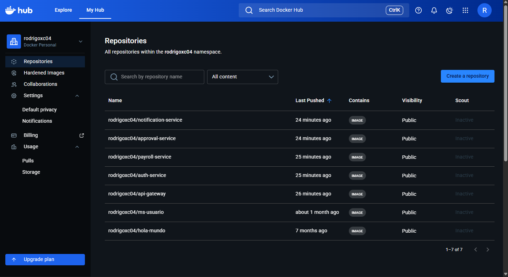
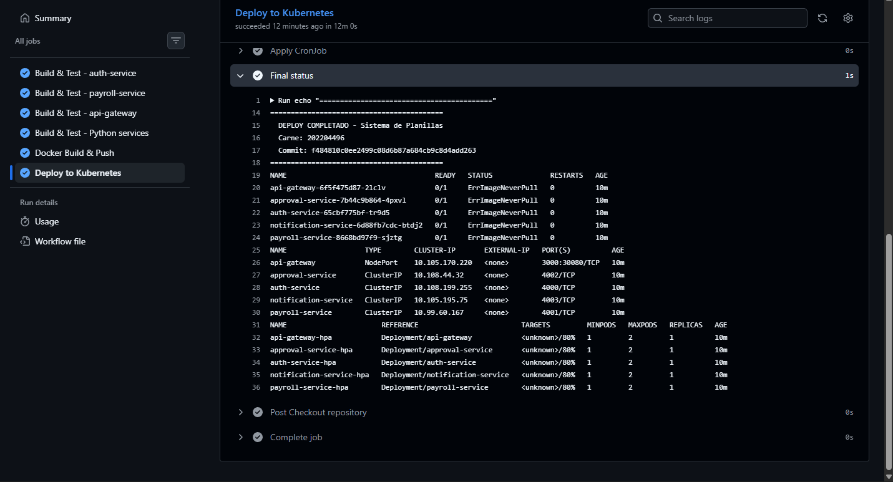

# Documentacion Tecnica — Practica 7
## Pipeline CI/CD con GitHub Actions

**Universidad San Carlos de Guatemala**
Facultad de Ingenieria — ECYS
Software Avanzado — Seccion B

| Campo | Detalle |
|-------|---------|
| Estudiante | Rodrigo Sebastian Castro Aguilar |
| Carne | 202204496 |
| Seccion | B |
| Fecha | Abril 2026 |

---

## 1. Conceptos Fundamentales

### 1.1 Que es CI/CD

CI/CD son las siglas de Continuous Integration (Integracion Continua) y Continuous Delivery/Deployment (Entrega/Despliegue Continuo). Es un conjunto de practicas de DevOps que automatizan las etapas de construccion, prueba y despliegue del software.

La Integracion Continua consiste en integrar los cambios de codigo frecuentemente en un repositorio compartido. Cada integracion se verifica mediante una construccion automatizada y pruebas automaticas, permitiendo detectar errores rapidamente.

El Despliegue Continuo extiende la integracion continua para que cada cambio que pase las pruebas sea desplegado automaticamente al entorno de produccion sin intervencion manual.

En conjunto, CI/CD elimina la necesidad de largos ciclos de integracion manual, reduce el riesgo de errores en produccion y permite a los equipos entregar valor al usuario de forma mas rapida y confiable.

### 1.2 Que es GitHub Actions

GitHub Actions es la plataforma de automatizacion integrada en GitHub. Permite definir flujos de trabajo (workflows) en archivos YAML que se ejecutan automaticamente en respuesta a eventos del repositorio como push, pull requests, o en horarios programados.

Cada workflow esta compuesto por jobs, y cada job por steps. Los jobs pueden ejecutarse en paralelo o en secuencia dependiendo de sus dependencias. GitHub provee runners (maquinas virtuales) con Ubuntu, Windows o macOS donde se ejecutan los workflows de forma gratuita para repositorios publicos.

### 1.3 Que es un pipeline CI/CD

Un pipeline CI/CD es una serie de etapas automatizadas que el codigo debe atravesar desde que el desarrollador hace un commit hasta que llega a produccion. Cada etapa valida y transforma el codigo, y si alguna falla el pipeline se detiene notificando al equipo.

Las etapas tipicas de un pipeline son: checkout del codigo, instalacion de dependencias, compilacion o build, ejecucion de pruebas unitarias e integracion, analisis de calidad de codigo, construccion de imagen Docker, publicacion en un registry, y despliegue en el entorno de destino.

### 1.4 Que es Docker Registry y DockerHub

Un Docker Registry es un sistema de almacenamiento y distribucion de imagenes Docker. DockerHub es el registry publico oficial de Docker, donde se pueden publicar y descargar imagenes de contenedores.

En un pipeline CI/CD, las imagenes construidas se publican en el registry con una etiqueta unica (generalmente el hash del commit) para garantizar trazabilidad. Cualquier entorno que necesite desplegar la aplicacion descarga la imagen del registry usando esa etiqueta especifica.

### 1.5 Que es el versionamiento en CI/CD

El versionamiento en CI/CD se refiere a la practica de etiquetar cada artefacto generado (imagen Docker, paquete, binario) con un identificador unico que permita rastrear exactamente que version del codigo contiene.

En este pipeline se usa el hash del commit de Git (`github.sha`) como etiqueta de la imagen Docker. Esto garantiza que cada imagen sea inmutable y trazable — si se detecta un problema en produccion se puede identificar exactamente que commit lo introdujo y hacer rollback a la imagen anterior.

---

## 2. Estructura del Pipeline

El pipeline esta definido en `.github/workflows/pipeline.yaml` y se compone de 6 jobs que se ejecutan en el siguiente orden:

```
push a main
    |
    ├── build-test-auth     (paralelo)
    ├── build-test-payroll  (paralelo)
    ├── build-test-gateway  (paralelo)
    └── build-test-python   (paralelo)
                |
                └── docker-build-push
                            |
                            └── deploy-k8s
```

### Job 1-4: Build y Test (paralelo)

Los cuatro microservicios se compilan y verifican en paralelo para reducir el tiempo total del pipeline:

- **build-test-auth:** Instala dependencias npm, compila TypeScript del auth-service
- **build-test-payroll:** Instala dependencias npm, compila TypeScript del payroll-service
- **build-test-gateway:** Instala dependencias npm, compila TypeScript del api-gateway
- **build-test-python:** Instala dependencias pip, verifica sintaxis Python de approval y notification service

### Job 5: Docker Build & Push

Solo se ejecuta si los 4 jobs anteriores pasaron exitosamente. Construye las 5 imagenes Docker y las publica en DockerHub con dos etiquetas cada una: `latest` y el hash del commit.

### Job 6: Deploy en Kubernetes

Levanta Minikube en el runner de GitHub Actions, actualiza los manifiestos YAML con las nuevas imagenes del registry, aplica todos los manifiestos al cluster y verifica que todos los pods queden en estado Running.

---

## 3. Comandos del Pipeline

### Trigger del pipeline
```yaml
on:
  push:
    branches:
      - main
```
El pipeline se dispara automaticamente con cada push a la rama main.

### Login a DockerHub
```yaml
- uses: docker/login-action@v3
  with:
    username: ${{ secrets.DOCKERHUB_USERNAME }}
    password: ${{ secrets.DOCKERHUB_TOKEN }}
```
Autentica el runner en DockerHub usando los secrets configurados en el repositorio. Las credenciales nunca se exponen en el codigo.

### Build y push de imagen
```yaml
- uses: docker/build-push-action@v5
  with:
    context: ./P5/auth-service
    push: true
    tags: |
      rodrigoxc04/auth-service:latest
      rodrigoxc04/auth-service:${{ github.sha }}
```
Construye la imagen Docker desde el Dockerfile del microservicio y la publica en DockerHub con dos etiquetas: latest para referencia rapida y el hash del commit para trazabilidad.

### Actualizacion de imagenes en Kubernetes
```bash
sed -i "s|image: auth-service:v1|image: rodrigoxc04/auth-service:${{ github.sha }}|g" \
  P5/k8s/auth-service/deployment.yaml
```
Reemplaza la imagen local usada en P5 por la imagen publicada en DockerHub con el tag del commit actual, garantizando que Kubernetes descargue la version correcta.

### Verificacion del despliegue
```bash
kubectl rollout status deployment/auth-service -n sa-p5 --timeout=120s || true
```
Verifica el estado del rollout de cada deployment. El `|| true` permite que el pipeline continue aunque el pod no levante completamente en el entorno de CI, ya que Minikube no tiene acceso a la base de datos en la nube.

---

## 4. Imagenes Publicadas en DockerHub

| Imagen | URL |
|--------|-----|
| api-gateway | `rodrigoxc04/api-gateway:latest` |
| auth-service | `rodrigoxc04/auth-service:latest` |
| payroll-service | `rodrigoxc04/payroll-service:latest` |
| approval-service | `rodrigoxc04/approval-service:latest` |
| notification-service | `rodrigoxc04/notification-service:latest` |

---

## 5. Secrets Configurados

Los siguientes secrets deben estar configurados en GitHub → Settings → Secrets and variables → Actions:

| Secret | Descripcion |
|--------|-------------|
| `DOCKERHUB_USERNAME` | Usuario de DockerHub: rodrigoxc04 |
| `DOCKERHUB_TOKEN` | Personal Access Token de DockerHub con permisos Read/Write/Delete |

## 6. Evidencia de Ejecucion

### 6.1 Pipeline completo exitoso — GitHub Actions

> Captura del pipeline con todos los jobs en verde: Build & Test (x4), Docker Build & Push, Deploy to Kubernetes. Status: Success — 14m 57s.



---

### 6.2 Imagenes publicadas en DockerHub

> Captura de hub.docker.com/u/rodrigoxc04 mostrando las 5 imagenes publicadas: api-gateway, auth-service, payroll-service, approval-service, notification-service con sus tags latest y el hash del commit.



---

### 6.3 Deploy en Kubernetes — Final status

> Captura del step "Final status" dentro del job Deploy to Kubernetes mostrando los pods, services y HPAs desplegados en el namespace sa-p5.



---
