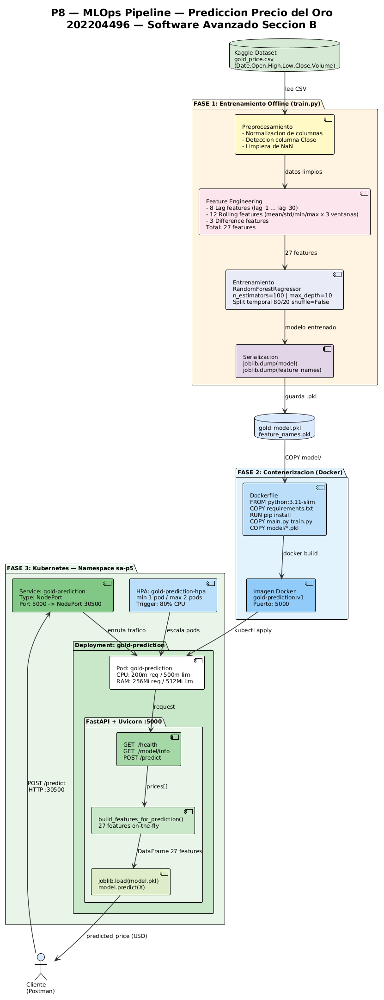
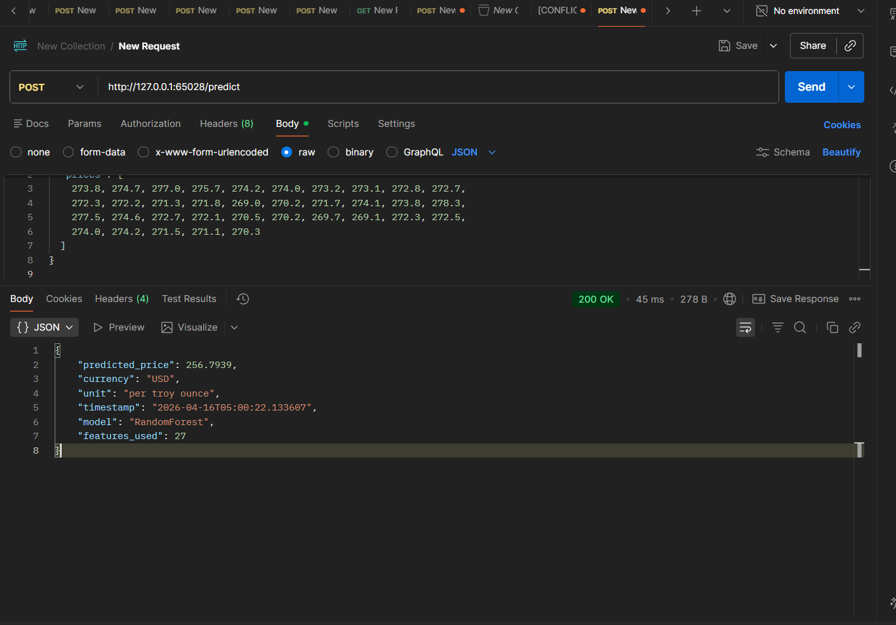
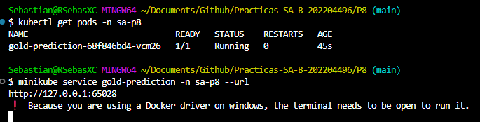
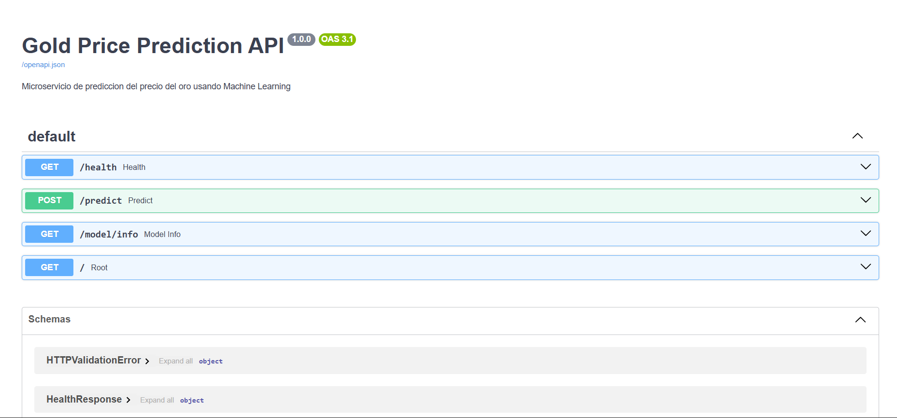

# Manual Tecnico — Practica 8
## Microservicio: Data Science — Prediccion del Precio del Oro

**Universidad San Carlos de Guatemala**
Facultad de Ingenieria — ECYS
Software Avanzado — Seccion B

| Campo | Detalle |
|-------|---------|
| Estudiante | Rodrigo Sebastian Castro Aguilar |
| Carne | 202204496 |
| Seccion | B |
| Fecha | Abril 2026 |

---

## 1. Descripcion del Proyecto

Este microservicio implementa un modelo de Machine Learning capaz de predecir el precio del oro (XAU/USD) a partir de datos historicos. El sistema procesa series de tiempo mediante feature engineering con lags y rolling statistics, entrena un modelo RandomForestRegressor, serializa el modelo en formato `.pkl` y lo expone mediante una API REST construida con FastAPI, desplegada en un cluster de Kubernetes.

---

## 2. Dataset Utilizado

**Fuente:** Kaggle — Gold Price Dynamics  
**URL:** https://www.kaggle.com/datasets/krupalpatel07/gold-price-dynamics/data  
**Archivo:** `gold_price.csv`

### Estructura del dataset

| Columna | Tipo | Descripcion |
|---------|------|-------------|
| Date | string | Fecha del registro |
| Open | float | Precio de apertura del oro (USD) |
| High | float | Precio maximo del dia (USD) |
| Low | float | Precio minimo del dia (USD) |
| Close | float | Precio de cierre del dia (USD) — columna objetivo |
| Volume | float | Volumen de transacciones |

El modelo utiliza la columna `Close` como variable objetivo ya que representa el precio de cierre del oro por onza troy en dolares estadounidenses.

---

## 3. Arquitectura del Sistema



---

## 4. Feature Engineering

Esta es la parte mas critica del pipeline. Los 27 features se calculan en tiempo de ejecucion (on-the-fly) dentro de la funcion `build_features_for_prediction()` a partir de la lista de precios historicos recibida en el request.

### 4.1 Lag Features (8 features)

Los lag features capturan el valor del precio en periodos anteriores, permitiendo al modelo aprender patrones de dependencia temporal.

| Feature | Descripcion |
|---------|-------------|
| lag_1 | Precio hace 1 periodo |
| lag_2 | Precio hace 2 periodos |
| lag_3 | Precio hace 3 periodos |
| lag_5 | Precio hace 5 periodos |
| lag_7 | Precio hace 7 periodos (1 semana) |
| lag_14 | Precio hace 14 periodos (2 semanas) |
| lag_21 | Precio hace 21 periodos (3 semanas) |
| lag_30 | Precio hace 30 periodos (1 mes) |

### 4.2 Rolling Features (12 features)

Los rolling features capturan estadisticas de ventanas moviles que describen la tendencia y volatilidad del precio en distintos horizontes de tiempo.

| Feature | Ventana | Descripcion |
|---------|---------|-------------|
| rolling_mean_7 | 7 dias | Media movil semanal |
| rolling_std_7 | 7 dias | Desviacion estandar semanal |
| rolling_min_7 | 7 dias | Minimo semanal |
| rolling_max_7 | 7 dias | Maximo semanal |
| rolling_mean_14 | 14 dias | Media movil quincenal |
| rolling_std_14 | 14 dias | Desviacion estandar quincenal |
| rolling_min_14 | 14 dias | Minimo quincenal |
| rolling_max_14 | 14 dias | Maximo quincenal |
| rolling_mean_30 | 30 dias | Media movil mensual |
| rolling_std_30 | 30 dias | Desviacion estandar mensual |
| rolling_min_30 | 30 dias | Minimo mensual |
| rolling_max_30 | 30 dias | Maximo mensual |

### 4.3 Difference Features (3 features)

| Feature | Descripcion |
|---------|-------------|
| price_diff_1 | Diferencia absoluta respecto al periodo anterior |
| price_diff_7 | Diferencia absoluta respecto a hace 7 periodos |
| price_pct_1 | Cambio porcentual respecto al periodo anterior |

### 4.4 Resumen

| Tipo de feature | Cantidad |
|-----------------|----------|
| Lag features | 8 |
| Rolling features | 12 |
| Difference features | 3 |
| **Total** | **27** |

---

## 5. Modelo de Machine Learning

### 5.1 Algoritmo

Se utiliza **RandomForestRegressor** de scikit-learn. Este algoritmo construye multiples arboles de decision sobre subconjuntos aleatorios del dataset y promedia sus predicciones, lo cual lo hace robusto frente a outliers y capaz de capturar relaciones no lineales en series de tiempo financieras.

### 5.2 Hiperparametros

| Parametro | Valor | Justificacion |
|-----------|-------|---------------|
| n_estimators | 100 | Balance entre precision y tiempo de entrenamiento |
| max_depth | 10 | Evita overfitting en series de tiempo |
| random_state | 42 | Reproducibilidad |
| n_jobs | -1 | Usa todos los nucleos disponibles |
| test_size | 0.2 | 80% entrenamiento, 20% validacion |
| shuffle | False | Respeta el orden temporal de los datos |

### 5.3 Serializacion

El modelo entrenado se serializa con `joblib` en dos archivos:

```
model/
├── gold_model.pkl       ← modelo RandomForestRegressor entrenado
└── feature_names.pkl    ← lista ordenada de los 27 features
```

El archivo `feature_names.pkl` garantiza que durante la inferencia se usen exactamente los mismos features en el mismo orden que durante el entrenamiento.

---

## 6. API REST

### 6.1 Especificaciones

| Campo | Valor |
|-------|-------|
| Framework | FastAPI 0.109.0 |
| Servidor | Uvicorn 0.27.0 |
| Puerto | 5000 |
| Documentacion | GET /docs (Swagger UI) |

### 6.2 Endpoints

#### GET /health
Verifica el estado del servicio y si el modelo esta cargado correctamente.

**Response:**
```json
{
  "status": "UP",
  "model_loaded": true,
  "features_count": 27,
  "timestamp": "2026-04-16T05:00:00.000000"
}
```

---

#### POST /predict
Genera una prediccion del siguiente precio del oro a partir de una serie historica de precios.

**Request Body:**
```json
{
  "prices": [1800.0, 1805.5, 1810.2, 1808.7, 1815.3,
             1820.1, 1818.9, 1825.4, 1830.0, 1828.5,
             1835.2, 1840.1, 1838.7, 1845.3, 1850.0,
             1848.5, 1855.2, 1860.1, 1858.7, 1865.3,
             1870.0, 1868.5, 1875.2, 1880.1, 1878.7,
             1885.3, 1890.0, 1888.5, 1895.2, 1900.1]
}
```

**Reglas del campo prices:**
- Tipo: lista de floats
- Minimo de elementos: 30
- Orden: del precio mas antiguo al mas reciente

**Response exitoso (200):**
```json
{
  "predicted_price": 256.7939,
  "currency": "USD",
  "unit": "per troy ounce",
  "timestamp": "2026-04-16T05:00:22.133607",
  "model": "RandomForest",
  "features_used": 27
}
```

**Response de error — modelo no cargado (503):**
```json
{
  "detail": "Modelo no disponible. Asegurese de que el modelo fue entrenado y el archivo .pkl existe."
}
```

**Response de error — menos de 30 precios (422):**
```json
{
  "detail": [
    {
      "type": "too_short",
      "loc": ["body", "prices"],
      "msg": "List should have at least 30 items after validation"
    }
  ]
}
```

---

#### GET /model/info
Retorna informacion detallada sobre el modelo cargado y los features que utiliza.

**Response:**
```json
{
  "model_type": "RandomForestRegressor",
  "features": ["lag_1", "lag_2", "...", "price_pct_1"],
  "features_count": 27,
  "model_path": "model/gold_model.pkl",
  "status": "loaded"
}
```

---

#### GET /
Endpoint raiz con informacion general del servicio.

**Response:**
```json
{
  "service": "Gold Price Prediction API",
  "version": "1.0.0",
  "student": "202204496",
  "endpoints": {
    "health":  "GET  /health",
    "predict": "POST /predict",
    "info":    "GET  /model/info",
    "docs":    "GET  /docs"
  }
}
```

---

## 7. Contenerizacion con Docker

### 7.1 Dockerfile

```dockerfile
FROM python:3.11-slim
WORKDIR /app
COPY requirements.txt .
RUN pip install --no-cache-dir -r requirements.txt
COPY main.py .
COPY train.py .
COPY model/ ./model/
EXPOSE 5000
CMD ["uvicorn", "main:app", "--host", "0.0.0.0", "--port", "5000"]
```

### 7.2 Dependencias (requirements.txt)

```
fastapi==0.109.0
uvicorn==0.27.0
pandas==2.1.4
numpy==1.26.3
scikit-learn==1.4.0
joblib==1.3.2
pydantic==2.5.3
```

### 7.3 Comandos de construccion

```bash
# Apuntar Docker al registro de Minikube
eval $(minikube -p minikube docker-env)

# Construir imagen
docker build -t gold-prediction:v1 .

# Verificar imagen
docker images | grep gold-prediction
```

---

## 8. Despliegue en Kubernetes

El microservicio se despliega en el namespace `sa-p5` junto con los demas microservicios del sistema.

### 8.1 Recursos desplegados

| Recurso | Nombre | Tipo |
|---------|--------|------|
| Deployment | gold-prediction | apps/v1 |
| Service | gold-prediction | NodePort :30500 |
| HPA | gold-prediction-hpa | autoscaling/v2 |

### 8.2 Configuracion de recursos del contenedor

| Parametro | Request | Limit |
|-----------|---------|-------|
| CPU | 200m | 500m |
| RAM | 256Mi | 512Mi |

### 8.3 Comandos de despliegue

```bash
kubectl apply -f k8s/gold-prediction.yaml
kubectl get pods -n sa-p5 -l app=gold-prediction
kubectl get service gold-prediction -n sa-p5
minikube service gold-prediction -n sa-p5 --url
```

---

## 9. Flujo Completo del Pipeline

```
1. Descarga del dataset (Kaggle)
         |
2. Preprocesamiento (train.py)
   - Normalizacion de columnas
   - Deteccion automatica de columna objetivo
   - Limpieza de datos
         |
3. Feature Engineering (train.py)
   - 8 lag features
   - 12 rolling features
   - 3 difference features
   - Eliminacion de NaN
         |
4. Entrenamiento (train.py)
   - RandomForestRegressor
   - Split temporal 80/20
   - Evaluacion MAE/RMSE/R2
         |
5. Serializacion (joblib)
   - gold_model.pkl
   - feature_names.pkl
         |
6. API REST (main.py)
   - FastAPI + Uvicorn
   - Recibe lista de 30+ precios
   - Reconstruye 27 features on-the-fly
   - Retorna predicted_price
         |
7. Contenerizacion (Docker)
   - Imagen: gold-prediction:v1
         |
8. Despliegue (Kubernetes)
   - Namespace: sa-p5
   - NodePort: 30500
   - HPA: 1-2 pods al 80% CPU
```

---

## 10. Evidencia de Ejecucion

### 10.1 API funcionando localmente — respuesta de /predict

> Captura de Postman o navegador mostrando el POST a /predict con respuesta exitosa 200 OK.



---

### 10.2 Pods corriendo en Kubernetes

> Captura del comando `kubectl get all -n sa-p5` mostrando el pod gold-prediction en estado Running junto con los demas microservicios.



---

### 10.3 Swagger UI — documentacion interactiva

> Captura de http://localhost:5000/docs mostrando los endpoints disponibles de la API.



---
