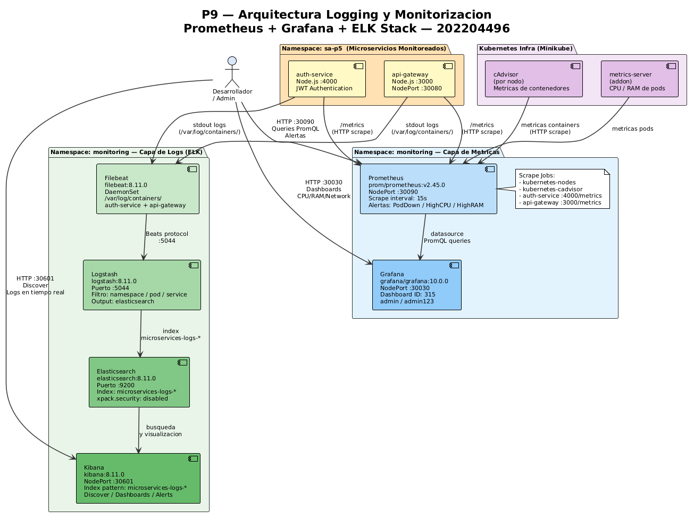

# Documentacion Tecnica — Practica 9
## Logging y Monitorizacion — Prometheus + Grafana + ELK Stack

**Universidad San Carlos de Guatemala**
Facultad de Ingenieria — ECYS
Software Avanzado — Seccion B

| Campo | Detalle |
|-------|---------|
| Estudiante | Rodrigo Sebastian Castro Aguilar |
| Carne | 202204496 |
| Seccion | B |
| Fecha | Abril 2026 |

---

## 1. Descripcion General

Esta practica implementa un sistema completo de observabilidad sobre los microservicios `auth-service` y `api-gateway` desplegados en Kubernetes. El sistema se divide en dos capas:

**Capa de Metricas:** Prometheus recolecta metricas de uso de CPU, RAM, red y estado de los pods. Grafana visualiza esas metricas en dashboards interactivos en tiempo real.

**Capa de Logs:** Filebeat recolecta los logs de los contenedores de ambos microservicios, los envia a Logstash para transformarlos, Logstash los indexa en Elasticsearch, y Kibana los visualiza con busqueda y filtros avanzados.

---

## 2. Arquitectura del Sistema



---

## 3. Herramientas Implementadas

### 3.1 Prometheus

Prometheus es un sistema de monitoreo y alerta de codigo abierto disenado para recolectar y almacenar metricas de series temporales. Funciona mediante un modelo de scraping: cada cierto intervalo (15 segundos en esta configuracion) consulta los endpoints `/metrics` de los servicios monitoreados y almacena los datos internamente.

En esta practica Prometheus recolecta metricas de los nodos del cluster (CPU, RAM, red), de los pods del namespace `sa-p5` via cAdvisor, y tiene configurados scrape jobs especificos para `auth-service` y `api-gateway`.

### 3.2 Grafana

Grafana es una plataforma de visualizacion de datos de codigo abierto que se conecta a Prometheus como datasource. Permite crear dashboards con paneles de graficas, medidores y tablas que se actualizan en tiempo real.

En esta practica se importo el dashboard oficial **Kubernetes cluster monitoring (ID: 315)** que muestra Network I/O pressure, Cluster memory usage, Cluster CPU usage, Pods CPU usage y Pods memory usage.

Credenciales de acceso: `admin` / `admin123`

### 3.3 ELK Stack

La pila ELK es un conjunto de tres herramientas para gestion centralizada de logs:

**Elasticsearch** es el motor de busqueda y almacenamiento. Indexa los logs recibidos en indices con formato `microservices-logs-YYYY.MM.dd`, permitiendo busquedas de texto completo en milisegundos sobre millones de registros.

**Logstash** es el pipeline de procesamiento de datos. Recibe los logs de Filebeat en el puerto 5044, los enriquece con metadata (namespace, pod, servicio) y los envia a Elasticsearch.

**Kibana** es la interfaz de visualizacion. Permite crear index patterns, explorar logs con busquedas KQL, crear dashboards y configurar alertas.

**Filebeat** es el agente recolector desplegado como DaemonSet en el cluster. Monitorea los archivos de log de los contenedores de `auth-service` y `api-gateway` en `/var/log/containers/` y los envia a Logstash.

---

## 4. Configuracion de Prometheus

### 4.1 Scrape Jobs configurados

```yaml
scrape_configs:
  - job_name: 'auth-service'
    static_configs:
      - targets: ['auth-service.sa-p5.svc.cluster.local:4000']
    metrics_path: '/metrics'

  - job_name: 'api-gateway'
    static_configs:
      - targets: ['api-gateway.sa-p5.svc.cluster.local:3000']
    metrics_path: '/metrics'

  - job_name: 'kubernetes-cadvisor'
    # recolecta metricas de contenedores via cAdvisor
```

### 4.2 Alertas configuradas

Se configuraron 3 alertas en el archivo `alert.rules.yml`:

| Alerta | Condicion | Severidad | Duracion |
|--------|-----------|-----------|---------|
| PodDown | `up == 0` | critical | 1 minuto |
| HighCPUUsage | CPU > 80% en namespace sa-p5 | warning | 2 minutos |
| HighMemoryUsage | RAM > 80% del limite definido | warning | 2 minutos |

### 4.3 Metricas consultadas

```promql
# Uso de memoria por pod en sa-p5
container_memory_usage_bytes{namespace="sa-p5"}

# Uso de CPU por pod
rate(container_cpu_usage_seconds_total{namespace="sa-p5"}[5m])

# Estado de los pods (1=up, 0=down)
up{job=~"auth-service|api-gateway"}
```

---

## 5. Configuracion ELK

### 5.1 Pipeline de Logstash

```
Filebeat (puerto 5044)
    ↓
Logstash filter:
  - add_field: service, namespace, pod
  - date match: ISO8601
    ↓
Elasticsearch index: microservices-logs-YYYY.MM.dd
```

### 5.2 Index Pattern en Kibana

Index pattern creado: `microservices-logs-*`

Campos principales disponibles en Kibana:
- `@timestamp` — fecha y hora del log
- `message` — contenido del log
- `kubernetes.pod.name` — pod que genero el log
- `kubernetes.namespace` — namespace
- `log.file.path` — ruta del archivo de log

---

## 6. Comandos de Despliegue

```bash
# Levantar Minikube con metrics-server
minikube start --driver=docker
minikube addons enable metrics-server

# Desplegar microservicios
kubectl apply -f P5/k8s/namespace.yaml
kubectl apply -f P5/k8s/configmap.yaml
kubectl apply -f P5/k8s/secret.yaml
kubectl apply -f P5/k8s/auth-service/
kubectl apply -f P5/k8s/api-gateway/

# Desplegar stack de monitoreo
kubectl apply -f P9/k8s/01-namespace-rbac.yaml
kubectl apply -f P9/k8s/02-prometheus-configmap.yaml
kubectl apply -f P9/k8s/03-prometheus-deployment.yaml
kubectl apply -f P9/k8s/04-grafana.yaml
kubectl apply -f P9/k8s/05-elk-stack.yaml
kubectl apply -f P9/k8s/06-filebeat.yaml

# Verificar pods
kubectl get pods -n monitoring
kubectl get pods -n sa-p5

# Obtener URLs de acceso
minikube service prometheus -n monitoring --url
minikube service grafana -n monitoring --url
minikube service kibana -n monitoring --url
```

---

## 7. Pods Desplegados

### Namespace monitoring

| Pod | Imagen | Estado |
|-----|--------|--------|
| prometheus | prom/prometheus:v2.45.0 | Running |
| grafana | grafana/grafana:10.0.0 | Running |
| elasticsearch | elasticsearch:8.11.0 | Running |
| logstash | logstash:8.11.0 | Running |
| kibana | kibana:8.11.0 | Running |
| filebeat | filebeat:8.11.0 | Running |

### Namespace sa-p5 (microservicios monitoreados)

| Pod | Puerto | Rol |
|-----|--------|-----|
| auth-service | 4000 | Autenticacion JWT |
| api-gateway | 3000 | Punto de entrada |

---

## 8. Evidencia de Funcionamiento

### 8.1 Prometheus — Metricas de memoria en tabla

> Consulta `container_memory_usage_bytes{namespace="sa-p5"}` mostrando uso de memoria de auth-service y api-gateway con valores en bytes.


---

### 8.2 Prometheus — Grafica de uso de memoria en el tiempo

> Vista Graph de la misma consulta mostrando la evolucion del uso de memoria de los pods en la ultima hora.


---

### 8.3 Grafana — Dashboard Kubernetes Cluster Monitoring

> Dashboard ID 315 mostrando Network I/O pressure, Cluster memory usage 44.6% (3.32 GiB de 7.44 GiB), Cluster CPU usage 5.55% (0.67 de 12.00 cores).


---

### 8.4 Grafana — Pods CPU y Memory usage

> Seccion inferior del dashboard mostrando Pods CPU usage y Pods memory usage de los microservicios desplegados.


---

### 8.5 Kibana — Logs centralizados de microservicios

> Vista Discover en Kibana mostrando 54 hits de logs recolectados por Filebeat de auth-service y api-gateway, incluyendo requests HTTP GET /health con timestamps en tiempo real.


---

## 9. Observaciones Tecnicas

**Scraping de metricas:** Los microservicios Node.js no exponen por defecto un endpoint `/metrics` en formato Prometheus. Las metricas de CPU y RAM mostradas provienen de cAdvisor que Kubernetes ejecuta en cada nodo, lo cual es suficiente para monitorear el consumo de recursos de los contenedores.

**Logs en Kibana:** Filebeat recolecta los logs de stdout de los contenedores desde `/var/log/containers/`. Los 54 hits visibles corresponden a los health checks automaticos del api-gateway y las respuestas HTTP de los microservicios.

**Alertas:** Las 3 alertas configuradas en Prometheus (PodDown, HighCPUUsage, HighMemoryUsage) se evaluan cada 15 segundos. En estado normal permanecen en estado `inactive`. Se activarian si algun pod cae o supera los umbrales de CPU/RAM definidos.

**Persistencia:** Los datos de Prometheus y Elasticsearch usan `emptyDir` por limitaciones de Minikube en Windows. En un entorno de produccion se usarian PersistentVolumeClaims para persistir los datos entre reinicios.

